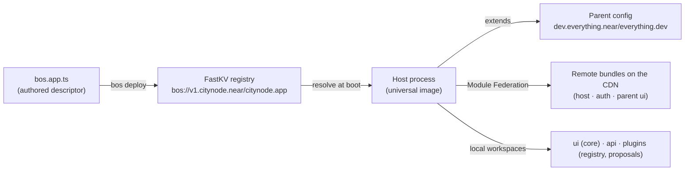
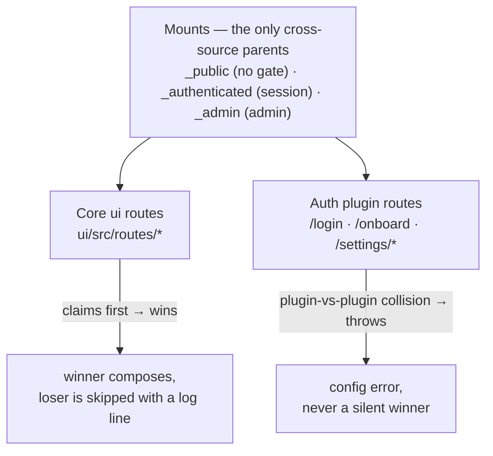
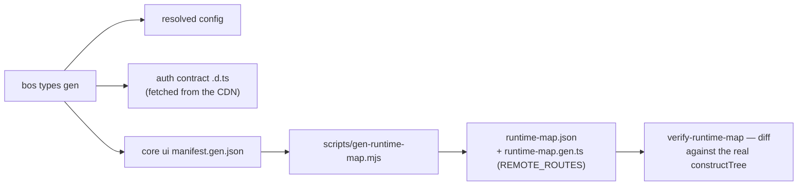

# How it all fits — the everything.dev runtime, drawn

For the human wondering how this app, the framework, and the deployed runtime
connect. Two companions: [`docs/runtime-map.md`](../runtime-map.md) is the
**operational** view (what is local vs remote, how to override) and
[`CONTEXT.md`](../../CONTEXT.md) is the domain vocabulary. An agent can teach any
section below interactively (`/teach`) — this file is the reference those
lessons cite.

## The chain: authored → published → resolved → served

One authored file is the whole argument. `bos deploy` publishes your config to
the registry under your NEAR account; the host resolves your config **through
the extends chain** at boot, downloads what the chain says is published, and
runs your local workspaces in-process next to it. `bos.dev.ts` alters the dev
resolution only; `_resolved` in `.bos/bos.resolved-config.json` records what the
resolution produced (regenerate: `pnpm run types:gen`).

## Composition: mounts, core-wins, shadows

A mount is a gate plus a pathless layout position, declared by a root-level
layout file. Routes from every source parent onto the shared mounts; when the
core claims a path a plugin also claims, **core ui wins** and the plugin's route
is shadowed (a log line, not an error). Composition degrades to a core-only tree
when a plugin bundle is missing — plugin paths then 404 by design, which is why
`pluginPath()` exists.

## Typed by generation, never hand-maintained

Every type surface is derived. `bos types gen` fetches the remote auth contract,
generates the core manifest, and (via `gen-runtime-map.mjs`) emits the typed
composition inventory. `pnpm run verify:runtime-map` proves the static model
still matches the engine. If a remote manifest fetch fails the build is
**loud**: an explicit `UNRESOLVED` beats a silently-shrinking map.

## Where source actually lives

| Want to change… | Where |
|---|---|
| A screen this app owns | `ui/src/routes/…` (claim wins) |
| An auth screen (`/login`, `/settings`) | locally **or** upstream `plugins/auth/` — see the runtime map's three ways |
| API behaviour | `api/src/contract.ts` + `index.ts`, or the owning plugin |
| Framework/auth internals | upstream repo → release → `platform:` pin bump |
| AGENTS.md, workflow docs, skills | synced paths — edit **and** upstream (see [`change-placement.md`](change-placement.md)) |

## Going deeper

- **Framework internals worth the dig** (source ships in `.pnpm/*/src`):
  composition engine `every-plugin/src/ui/manifest/construct.ts`; typegen
  `everything-dev/dist/services/codegen/`; path typing
  `@tanstack/router-core/dist/esm/routeInfo.d.ts`; sync/ownership
  `everything-dev/dist/services/scaffold/{sync,ownership}.mjs`; remote route
  manifests are served at `<ui.production>/manifest.gen.json`.
- **Decisions**: upstream ADRs resolve via
  [`docs/adr/README.md`](../adr/README.md).
- **Issues family**: everything-dev #345/#346 (typesafe `to`), #591 (composition
  inspector), #531 (non-gating regression), #577 (docs parity).
- **Learn it interactively**: run `/teach` with a question about any section
  above — lessons are built from this reference and pin their claims to it.
